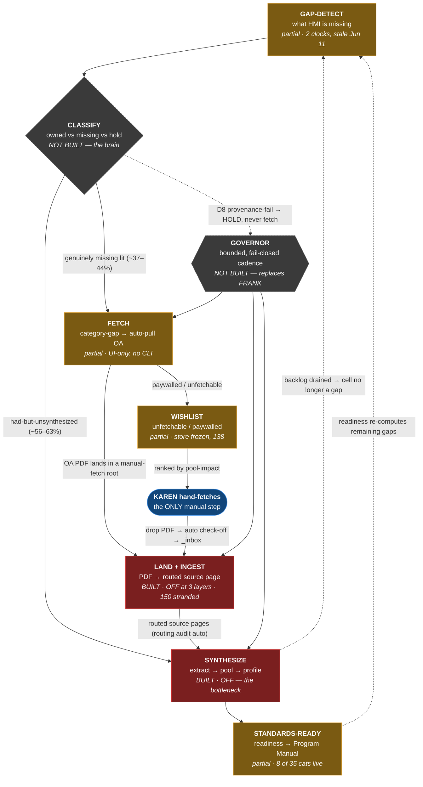

# Autonomous acquisition → standards loop

> **Superseded methodology design (2026-08-12).** This document describes the retired occurrence-selected standards-finalization loop and is retained only as an architecture history record. Current initial HMTc limits are government-limit-only. The active acquisition workflow closes descriptive occurrence and routing gaps in `data/gaps/open_gaps.jsonl`; it cannot finalize or change a certification limit. Post-publication tightening uses eligible HMTc certified-lot data under Governance Policy §12.

Status: DESIGN (2026-07-27). Author: Claude (Opus 4.8), grounded by an 8-agent
live-state map of the repo (`gap-detect → fetch → wishlist → ingest → synthesize →
standards-ready`) plus a synthesis pass. This is the coherence artifact for the
loop Karen asked for on 2026-07-27: gaps gathered from HMI, category gaps auto-pull
papers, fetched papers auto-ingest, ingested evidence auto-synthesizes, standards
finalize — and the *only* manual step is Karen hand-fetching the wishlist entries
the app couldn't grab.

Companion: [[library-fetch-sync-plan]] (Phases 1–2 shipped: identity index +
wishlist). This doc is the loop that connects those pieces to standards.

---

## 0. The reframe — read this before building anything

**Karen asked for an autonomous FETCH loop. The evidence says fetching is mostly
avoidance, not progress.** The Fable5 356-row readiness audit is decisive: of the
**~2,291 real gap cells**, ~**1,290 (56–63%)** are fixable from evidence *already
in the corpus* (compile / route / pool source pages we already own), and only
~**1,001 (37–44%)** genuinely need new literature.

Concrete: **rice Cd has 162 owned source pages but only 8 synthesized.** Fetching
a 163rd paper there moves nothing. The stage that is actually cold is
**SYNTHESIZE** — the `extract → pool → populate` value chain has been dead since
mid-June because it was only ever driven by the retired FRANK daemon, and the
backlog detector that would trigger it writes a CSV (`ingredient-synthesis-backlog.csv`,
**775 starved cells / 107 severe**) that nothing reads.

So the loop's dead links are **`LAND→INGEST`** and **`INGEST→SYNTH`**, not fetch.
The "orchestrator is off after a cost incident" fact is real but secondary: it
explains why the loop *stopped*, not what to *build*. The highest-leverage build is
an **autonomous synthesis driver over owned evidence**, made safe by a bounded
fail-closed governor — not more fetching. Fetch is the minority closer, and even
Karen's manual wishlist should be ranked by pool-impact so her hand-fetches hit the
cells literature genuinely can't be found for otherwise.

---

## 1. Current state — every stage is built, almost nothing is running

| Stage | Status | Key file | Reality |
|---|---|---|---|
| GAP-DETECT | ◑ built-manual | `build-standards-gap-report.mjs` → `open_gaps.jsonl` | Detectors run on **two clocks**. Routing family auto-refreshes (chokidar+pre-commit+prebuild). But the standards-gap chain is hand-run (`npm run evidence:standards-gaps`) and `open_gaps.jsonl` is **stale (Jun 11, 622 rows)**. No direct per-`hmtc_category` gap column. |
| FETCH | ◑ built-manual | `fetch-app/lib/run.mjs` `runFetch()` + `discover-autopilot.mjs` | `runFetch()` is a clean importable fn but has **no CLI** — its only caller is the browser UI. `discover-autopilot` is gap-wired but only into FRANK (off, `~/.discover.STOP` present). **Every fetch today is human-initiated.** |
| WISHLIST | ◑ built-manual | `wishlist/lib/fulfill.mjs`, central-library `/api/wishlist` | Harvest+score are manual-only; `wishlist.jsonl` frozen Jul 6, **138 open entries**. Drop-to-check-off works only through the central-library app's in-app drop zone. `fulfillment-watcher.mjs` is wired to zero daemons. |
| LAND+INGEST | ● built-OFF | `ingest-manual-fetch-batch.mjs` / skill `ingest-next-manual-fetch-pdf` | Ingester is code-correct and watches all 4 roots (incl. the fetch/discover drop dir) but **off at three layers**: no launchd job loaded, `~/.heavymetalindex.STOP` present, FRANK retired. Concurrency hard-clamped to 1 (per-PDF commits race on `.git/index.lock`). **~150 fetched PDFs sit un-ingested right now.** Last autonomous ingest commit: Jun 22. |
| SYNTHESIZE | ● built-OFF | `populate-contamination-profile.mjs` + `audit-ingredient-synthesis-backlog.mjs` | **THE broken link.** Prebuild only *routes* + *re-renders* tables; it produces no new numeric values. The three value-producing steps (`extract-source-values` cold since Jun 19 **and carrying a 1000× unit bug**; `evidence:pooling`; `populate-contamination-profile` cold since Jun 11) were only ever chained by FRANK. **2,006 routed pages do not reach a profile value automatically.** |
| STANDARDS-READY | ◑ built-manual | `build-category-standards-readiness.mjs` + `build-standards-qc-gate.mjs` | QC gate (C1–C11) is build-blocking and live (0 critical-fail). But the readiness monitor sees only the 15 locked pages (8 of 35 categories); the other 27 have no live readiness signal. MANUAL-READY only *prints* the build command — a human runs `build-category-manual.mjs` to mint the Program Manual. |

Legend: ● built-OFF · ◑ built-but-manual/partial · ○ not built.

---

## 2. The loop

The two **feedback loops** are the point:

1. **`SYNTH → GAP` / `STD → GAP`** — as owned evidence is synthesized and standards
   firm up, the gap register shrinks, so the next cycle stops chasing cells that are
   already covered. Without this the loop re-does closed work forever.
2. **`CLASSIFY → SYNTH` vs `CLASSIFY → FETCH`** — the router that sends
   had-but-unsynthesized cells to synthesis (local, free) and only genuinely-missing
   cells to fetch (network, budget). This is the single wire that stops the loop from
   burning money re-fetching what's on the drive.

---

## 3. The classify router — the missing brain

`CLASSIFY` is new and small, and it is what makes the loop *smart* instead of a
fetch firehose. For each gap cell it reads three existing registers and routes:

- **Backlog says we own ≥3 sources but synthesized < needed** → **SYNTHESIZE** (do
  not fetch). ~56–63% of cells.
- **No cited evidence in corpus, no owned sources** → **FETCH** (genuinely missing).
  ~37–44%.
- **D8 provenance failure** (orphan citation, unresolved routing) → **HOLD**. Fetching
  cannot fix a broken provenance link; surface it, never spend on it.

This is `tools/wishlist/gap-to-queries.mjs` in the [[library-fetch-sync-plan]]
(specced, never built) plus the backlog join.

---

## 4. The governor — autonomous but fail-closed (the FRANK lesson)

The retired FRANK caused the **2026-06-09 token runaway** because it was a
self-restarting `launchd KeepAlive` daemon with no spend ceiling. **Do not rebuild
that shape.** The replacement is **pull-based and fail-closed**:

1. **One scheduled task** (`mcp scheduled-tasks` or a single cron), *not* a
   self-restarting agent, fires one `governed-tick.mjs` every N hours (start N = 6–12).
   No KeepAlive, no relaunch-on-crash.
2. **Every tick checks `~/.heavymetalindex.STOP` first** and exits in <1s if present.
   The belt-and-suspenders halt stays.
3. **Fail-closed default = idle.** If `data/evidence/autonomy/budget-ledger.json` is
   absent or unconfigured, the tick exits 0 doing nothing. Running requires an explicit
   config, not the absence of a stop.
4. **Hard caps per tick:** e.g. ≤5 synthesis cells and ≤10 fetch queries. A per-tick
   token/$ estimate is computed *before* spawning any child; the tick aborts if
   projected spend exceeds the per-tick ceiling. A running per-day ceiling in the
   ledger aborts further ticks once hit.
5. **Synthesis before fetch in every tick** (synthesis is local, cheap, the actual
   bottleneck). Fetch children are gated behind the classify router so
   had-but-unsynthesized cells never spend fetch budget.
6. **Drive-dependent steps exit cleanly if HMI-Library is unmounted.**
7. **Immutable ledger + human checkpoint.** Every action + cost appends to a ledger;
   a morning report summarizes each night's work. Escalating batch size beyond the
   seed caps requires Karen flipping a resume flag after reading the report.

This gives the mostly-autonomous loop while structurally preventing an unbounded spend.

---

## 5. Build plan (dependency order, each a shippable slice)

| Phase | Ships | Depends on | Owner |
|---|---|---|---|
| **P1 — Truthful gap picture on one clock** | `npm run evidence:refresh` (`refresh-gaps.mjs`) that runs every detector against the current corpus and *always* regenerates `open_gaps.jsonl` last; adds `hmtc_category` as a direct column + per-category BLOCKED rollup. Gaps reflect the 2,006-page reality; "category gap" becomes a lookup. | — | Claude |
| **P2 — Autonomous synthesis over owned evidence** (the unlock) | `run-synthesis-batch.mjs` consuming `ingredient-synthesis-backlog.csv` severe rows through `extract → pool → populate` with `review_events` logging, **plus the `extract-source-values` 1000× unit-fix as a hard precondition.** Runnable by hand first. Already-owned evidence starts reaching profiles + the standards pool. | P1 | Claude |
| **P3 — Fail-closed governed cadence** | `governed-tick.mjs` wrapping the existing `governor.mjs`, a `budget-ledger.json`, and ONE `scheduled-tasks` entry (no KeepAlive). Wraps P2 (and the ingest batcher) in bounded, STOP-gated, budget-capped ticks. | P2 | Claude + Karen go |
| **P4 — Genuine-fetch closer + live wishlist** | `gap-to-queries.mjs` (with backlog-synthesize + provenance-hold gates) and `fetch-app/run-cli.mjs` (headless `runFetch` via freeform topics), driven under the P3 governor for the truly-missing cells; post-fetch `wishlist:harvest+score` + `fulfillment-watcher` under the tick. | P1, P3 | Claude |
| **P5 — Steady-state hygiene** | Gap status write-back (attempted/closed) so closed cells stop generating jobs; turn on the `pool_impact` wishlist score term; optional coverage-ledger "fetch this next" worklist. | P4 | Claude |

**In parallel, right now (independent of P1–P5):** drain the ~150 stranded
manual-fetch PDFs into source pages. This is the dead `LAND+INGEST` node, it needs
no new code, and it is the correct job to hand to a Codex fast-mode session as scut
work (§6). It does not *finalize* standards by itself, but it clears fetched-but-stranded
evidence into the corpus so P2 can synthesize it.

---

## 6. Codex lane — parallel scut work without a commit race

Codex (ChatGPT, fast mode) drains ingest; Claude builds P1–P3 and runs the
independent audit. The two must not collide on `main` (documented FRANK/Codex commit
race: concurrent commits fight over `.git/index.lock` and the reverse sweep clobbers).

**Lane separation (the guardrail that makes this safe):**

- **Codex touches only:** new `wiki/sources/<cite-key>.md`, `data/evidence/audit-queue.csv`,
  and the routing-audit CSVs it regenerates. **Explicit-filename staging only** — never
  `git add -A/-u/.`. One commit per PDF. No push. One PDF at a time, serially.
- **Claude touches only:** `tools/**`, `docs/**`, `package.json`, `data/evidence/autonomy/**`,
  and works on a branch/worktree so tool-building never fights Codex's per-PDF commits on
  `main`. Claude lands tool commits in quiet windows.
- **Audit split:** Codex ingests + verifies its own numbers and marks the queue row
  `status=pending`; Claude runs the independent fresh-context audit sweep afterward
  (this is *more* independent than the same-session subagent, and keeps Codex fast). The
  per-PDF routing audit (build-blocking) still runs, so no malformed page lands.

The paste-ready Codex prompt lives in the chat handoff and is reproduced at
[[codex-ingest-drain-prompt]] if extracted.

---

## 6b. Measured state — 2026-07-27 (what "distance to done" actually is)

The loop now has a **brain and a done-meter**: `tools/evidence/build-standards-row-classifier.mjs`
→ `data/evidence/standards-row-classifier.csv`. It classifies every in-scope
`(product row × analyte)` and routes it. Definition of done: every row
DEFENSIBLE (a Part-19 rationale tag) or ADJUDICATE — **not** every PDF ingested.

**594 in-scope rows → 107 DEFENSIBLE (18%).** Worklist:

| next_action | rows | who closes it |
|---|---:|---|
| DONE | 107 | — |
| FETCH_INGEST | 264 | Codex bulk drain (research-pulls/Kimi) + fetch-app |
| EXTRACT_SYNTH | 216 | the value chain (unit-fix ✓, validation gate ✓, re-pool ✓, slug-recovery pending rice-scope call) |
| CAP_MAP | 4 | cap-mapper (see below) |
| FIX_POOL | 3 | extraction validation |

**The FETCH_INGEST count (264) is inflated.** Only 4 rows route to CAP_MAP
because `product_regulatory_crosswalk.csv` maps just 16 of 107 no-data products.
Many of the 264 almost certainly fall under an existing EU 2023/915 / FDA / Codex
ML that isn't mapped. **Expanding the cap crosswalk (real regulatory values, zero
fetch) is the single highest-leverage lever** — it flips rows FETCH_INGEST →
CAP_MAP → DONE with no data work. It is also defensibility-critical (a wrong ML
is a liability), so it is careful regulatory-sourcing work, not a fast pass.

**Session commits (2026-07-27):** `0477b1234` unit-fix · `50ecf0184` validation
gate · `2b92ab558` gap hmtc_category · `a1c3b5b59` quarantine-aware re-pool ·
`8547d389e` research-pulls roots · `12cee5ff3` row classifier.

**Open decisions:** (1) the 305 `grain-based-snacks-rice-status-unspecified`
extract cells — in-scope (recover) or quarantined-by-design (leave); (2) cap-mapper
approach — source new MLs vs broaden existing 43 caps' scopes (both need care).

## 7. What is already done (don't rebuild)

- Identity index + committed snapshot (Phase 1 of the sync plan): `library:index|snapshot`.
- Wishlist harvest/score/fulfillment + the central-library Wishlist tab: `wishlist:harvest|score|watch`.
- The ingest pipeline itself (`ingest-manual-fetch-batch.mjs` + the skill) — it works, it's just switched off.
- The QC gate (C1–C11) — build-blocking, live.
- FRANK v2 governor code (`governor.mjs`, `governed-run.mjs`) — built, never enabled. P3 wraps it.
