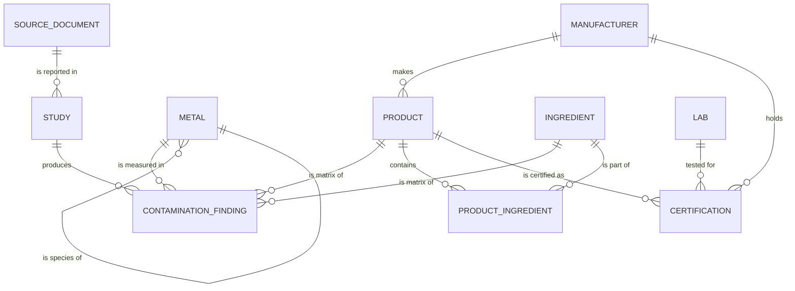

# Heavy Metal Index — Data Model v0

**Status:** v0, ships with HMI-3.
**Owner:** CTO.
**Source of truth:** `db/schema.ts`. This document explains it.

## Why this exists

The wiki under `wiki/` is a Quartz-compiled markdown corpus. It is the
authoring surface and the public reading surface, and it is the right place
for the substance of the Heavy Metal Index. It is not the right shape for:

- programmatic queries from the future consumer app (CLAUDE.md Part 22),
- the certification surface at `heavymetaltested.com` (Part 3),
- API consumers (regulators, retailers, journalists),
- and the long-term defensibility argument, which depends on per-claim
  provenance that survives source withdrawal (Part 1, database-rights
  positioning).

The data model in `db/schema.ts` is a relational projection of what the
wiki already encodes in YAML frontmatter and markdown tables. Source pages
remain the system of record during authoring. The DB exists so the same
content can be queried, joined, and exposed as an API.

v0 is deliberately minimal. The eight entities the issue specifies, plus
`ingredient` and `product_ingredient` (which the wiki already uses and
which the consumer app explicitly needs), and nothing else. We are not
modelling regulations, thresholds, exposure scenarios, microbiome
interactions, or wiki-style synthesis state at this stage. Those are v1+.

## Stack choices

| Decision | Choice | Why |
| --- | --- | --- |
| Database | Postgres | AGENTS.md default. Production target is Vercel Marketplace Postgres (Neon). |
| ORM | Drizzle | TypeScript-native, schema-as-code, dialect-portable migrations, no runtime cost beyond `pg`. |
| Dev DB | PGlite (`@electric-sql/pglite`) | Real Postgres semantics, no external server. Lives at `.pglite/`, gitignored. |
| Migrations | Drizzle Kit | `npm run db:generate`. Migrations under `db/migrations/`. |
| Seed | `db/seed.ts` | Idempotent: truncates + reinserts. Values are real, drawn from existing wiki source pages. |

PGlite is a one-way decision *for v0 dev*, not for production. The same
migration SQL runs against Neon/Vercel Postgres when the cloud DB is
provisioned (a separate, future ticket).

## Entities



### Public Index surface (`metal`, `source_document`, `study`, `product`, `ingredient`, `contamination_finding`)

This is the half of the schema the wiki and any public app may query
freely. No brand identity flows through it. A finding traces to a study
traces to a source document, and that is the entire provenance chain.

### Certification surface (`manufacturer`, `lab`, `certification`)

These tables live in the same schema but are not joined into public
queries. They exist so the HMT&C program at heavymetaltested.com has a
home; the brand firewall (CLAUDE.md Part 12) is enforced at the
application layer, not by separating databases. See "Brand firewall"
below.

## Entity-by-entity reasoning

### `metal`

Controlled vocabulary keyed by `code` (e.g. `Pb`, `iAs`, `Cr-VI`).
Self-referential: `parent_metal_id` lets us model species-of relationships
that CLAUDE.md Part 14 lists as non-negotiable distinctions —
**iAs is a species of tAs, MeHg of tHg, Cr-VI of Cr**. Findings must point
at the specific species code reported, not be silently aggregated up the
tree. `is_hmtc_analyte` flags rows in the official 10-analyte
certification panel.

### `source_document`

The verifiable origin of any claim. `cite_key` matches the wiki's
`docs/conventions.md` cite-key format, so a DB row and a `wiki/sources/`
page can be cross-referenced 1:1. `doi` is unique-when-present; `raw_path`
points back at the immutable PDF/markdown in `raw/`. `evidence_tier` is
the same A/B/C tier the wiki uses.

### `study`

Sits between source and finding because a single source document can
contain multiple distinct studies (a meta-analysis with several cohorts,
an agency report bundling separate sampling campaigns). `methodology_grade`
is graded separately from `evidence_tier` on the parent source — a B-tier
report can contain an A-graded study and vice versa, and we want both
visible.

### `product` and `ingredient`

`product.is_class` defaults to `true` because the public Index is mostly
product *categories*, not branded SKUs. A specific SKU (`is_class=false`)
links to a manufacturer; a category does not. `product.wiki_product_slug`
and `ingredient.wiki_ingredient_slug` point back at the canonical wiki
page.

`product_ingredient` is many-to-many with an optional `proportion_pct`.
Public Index rows will not have proportions; the consumer app described
in CLAUDE.md Part 22 needs the relationship to estimate exposure from
ingredient lists.

### `contamination_finding`

The one row that matters most. Every constraint here is load-bearing:

- `study_id NOT NULL` — provenance is non-negotiable (issue HMI-3 explicit).
- `metal_id NOT NULL` — every value answers "of what?"
- `product_id OR ingredient_id NOT NULL` — enforced by a SQL `CHECK`
  constraint, not application validation. At least one matrix must be
  set. Both may be set when the finding is "lead in rice in this brand of
  baby cereal."
- `basis` — wet/dry/as-consumed/as-sold/oil-fraction. Not a stylistic
  choice; the wiki's basis-conversion rules (CLAUDE.md Part 19) depend on
  it.
- `statistic_type` — mean/median/p95/max/single-sample/lod-censored-mean.
  Aggregating a `max` and a `mean` into the same percentile pool is the
  failure mode this column exists to prevent.
- `value_ppb` (`numeric(14,6)`) — six decimal places of µg/kg gives
  sub-nanogram precision and avoids float drift on small values.
- `value_low_ppb`/`value_high_ppb` — for ranges.
- `sample_n`, `detection_limit_ppb`, `below_lod_count` — confidence is
  represented as actual fields, not a yes/no flag. The issue called this
  out explicitly.
- `analytical_method` — ICP-MS / HPLC-ICP-MS / GFAAS / etc. Method matters
  for credibility of speciated measurements (iAs reported by ICP-OES
  alone is suspect; HPLC-ICP-MS is the canonical method).
- `confidence` — `high`/`medium`/`low`. A synthesised methodology grade,
  not the same as the tier on the source. Captures judgment calls that
  don't fit the structured fields.

### `manufacturer`, `lab`, `certification`

Present so the certification surface has a home, but **the seed does not
load real brand or lab data**. Placeholder rows demonstrate the linkage
and nothing more. Real brand/lab data lives behind permissioned access
and arrives in v1+ when the certification program goes live.

## Brand firewall

CLAUDE.md Part 12 is explicit: no brand-specific contamination data in
the public wiki. The DB inherits that rule. Operationally:

- Public Index queries MUST NOT join through `manufacturer`. Treat
  `manufacturer_id` on `product` as a private field at the query layer.
- The wiki build (`wiki/` -> `public/`) does not consume the DB. The DB
  consumes the wiki, not the other way around.
- Findings tied to a branded product (`product.is_class=false`) are
  staff-only until a future "aggregate-anonymised" view is built. The
  schema does not enforce this; the query and API layers will.
- Certifications are never published into wiki pages. They land on
  heavymetaltested.com, which is a separate site that reads the same DB
  through a separate (certification-scoped) auth context.

This is the rule the brand-intelligence build in CLAUDE.md Part 26 is
designed for. v0 keeps the schema unified so we don't pay a migration
cost when that build comes online, but the brand-firewall discipline
applies from day one.

## Wiki ↔ DB linkage

For v0, the wiki remains authoritative for content. The DB is populated
from the wiki via ingest tools (to be built — separate ticket). To make
that future linkage trivial:

- `source_document.cite_key` matches `wiki/sources/*.md` cite-keys.
- `source_document.wiki_source_slug` is the filename without extension.
- `product.wiki_product_slug` and `ingredient.wiki_ingredient_slug`
  match the corresponding wiki page slugs.

A wiki page is the human-readable rendering. A DB row is the queryable
projection. The cite-key is the join key.

## What v0 deliberately does *not* model

| Concept | Why deferred |
| --- | --- |
| Regulations and threshold limits | Need a Scientific Advisor in the loop to decide how to represent jurisdictional differences and ALARA ratchet history. Issue HMI-3 explicit about escalating methodology calls. |
| Synthesis state per (ingredient, metal) cell | Belongs near the wiki, not in the DB, until the wiki/DB sync is mechanical. |
| Microbiome / exposure / health-effect rows | Not in HMI-3 scope. |
| Brand-level findings | Brand firewall + Part 26 separate-repo plan. |
| Source-page routing fan-out (`product_source_routing_audit.csv`) | Lives in the wiki build pipeline. Will be regenerated *from* the DB once ingest is bidirectional. |

These are real entities the Index will eventually need. They are not
this ticket.

## Open questions for the Scientific Advisor (when hired)

- Should `methodology_grade` derive from a structured rubric instead of
  an enum? (Probably yes once the rubric is written.)
- How do we represent below-LOD censoring beyond `below_lod_count`? Lower
  / upper / middle bound? KM-style imputation? Hold for advisor.
- Is `confidence` redundant with `methodology_grade` + `evidence_tier` +
  `statistic_type`? Possibly. Keeping it for now because the wiki uses a
  separate confidence field; reconcile in v1.

## How to use it locally

```bash
npm install
npm run db:seed       # applies migrations and seeds; idempotent
npm run db:reset      # nukes .pglite/ and reseeds
npm test              # includes db/schema.test.ts which exercises the model end-to-end
```

Sample query (from `db/seed.ts`):

```ts
const leadFindings = await db
  .select({
    metalName: metal.name,
    productName: product.name,
    valuePpb: contaminationFinding.valuePpb,
    citeKey: sourceDocument.citeKey,
    evidenceTier: sourceDocument.evidenceTier,
  })
  .from(contaminationFinding)
  .innerJoin(metal, eq(metal.id, contaminationFinding.metalId))
  .innerJoin(product, eq(product.id, contaminationFinding.productId))
  .innerJoin(study, eq(study.id, contaminationFinding.studyId))
  .innerJoin(sourceDocument, eq(sourceDocument.id, study.sourceDocumentId))
  .where(eq(metal.code, "Pb"))
```

This query returns lead findings joined all the way back to the
peer-reviewed or agency source they came from. That join chain is the
moat.
